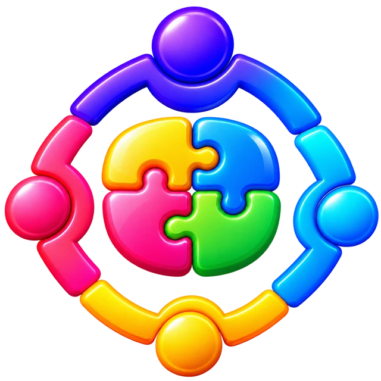



# Treasury System

### Las cuentas claras. La comunidad más cerca.

Una aplicación web para organizar la tesorería, las familias y las actividades de una comunidad escolar.

**Cuotas y pagos · Ingresos y gastos · Eventos y stands · Horario de clases · Comunidad**

[Conoce la app](#qué-es-treasury-system) · [Funcionalidades](#qué-puedes-hacer) · [Ejemplos](#así-se-utiliza-en-el-día-a-día) · [Primeros pasos](#cómo-empezar)

> Las imágenes de esta presentación son ilustraciones utilizadas por el proyecto; no son capturas de sus pantallas. Los nombres y montos de los ejemplos son ficticios.

## Qué es Treasury System

Treasury System reúne en un mismo espacio la gestión económica y la organización de un curso: quiénes forman parte de la comunidad, qué aportes se han registrado, cuánto queda pendiente y cómo avanzan las actividades compartidas.

Está pensada para acompañar a la directiva y a los apoderados en tareas cotidianas. Desde registrar un abono a la cuota anual hasta revisar el resultado de una kermés, permite mantener la información relacionada y consultar los movimientos del curso con más contexto.

La propuesta es sencilla: dedicar menos tiempo a reconstruir cuentas dispersas y más tiempo a los proyectos de la comunidad.

## A quién está dirigida

| Participante | Cómo le ayuda |
| --- | --- |
| Directiva y tesorería del curso | Organizar cuotas, registrar movimientos, gestionar actividades y preparar rendiciones. |
| Administración | Mantener alumnos, apoderados, familias y cuentas de acceso; administrar el contenido del curso según sus permisos. |
| Apoderados | Consultar sus cuotas, presentar comprobantes de transferencia y encontrar información de su comunidad. |

Las herramientas visibles y las acciones disponibles dependen del perfil y de los permisos de cada cuenta.

## Qué puedes hacer

### 1. Organizar alumnos, apoderados y familias

  

La gestión comienza por las personas. La aplicación permite administrar alumnos y apoderados, y relacionarlos mediante una familia.

- Crear, consultar y actualizar los registros de alumnos y apoderados.
- Asociar al alumno con sus apoderados y registrar el parentesco.
- Identificar el contacto principal de una familia.
- Relacionar la organización de las familias con el seguimiento de sus aportes.
- Gestionar el acceso de los apoderados a la aplicación.

Esto aporta contexto a las cuentas: cada registro económico puede entenderse dentro de la organización del curso.

### 2. Llevar las cuotas y los aportes

La tesorería permite organizar la cuota anual y seguir los pagos registrados, los abonos y los saldos pendientes.

- Configurar la cuota anual y las modalidades disponibles.
- Consultar obligaciones y pagos de las familias.
- Registrar abonos para dar seguimiento a una cuota.
- Gestionar aportes CEPA y Solidaria.
- Presentar comprobantes de transferencia y revisar su estado en el flujo correspondiente.
- Revisar los comprobantes desde la administración y registrar la aprobación cuando corresponda.

Un comprobante presentado debe pasar por la revisión correspondiente antes de considerarse un pago aprobado. Esta distinción ayuda a separar lo informado por una familia de lo confirmado por la administración.

### 3. Registrar ingresos y gastos

Los movimientos del curso se reúnen para facilitar el seguimiento de los recursos y la preparación de las cuentas.

- Registrar ingresos y egresos.
- Consultar la información de los movimientos y sus comprobantes cuando corresponda.
- Revisar el resumen financiero del curso.
- Consultar reportes para apoyar la rendición de cuentas.
- Conservar el seguimiento de las operaciones de tesorería y sus anulaciones.

La utilidad va más allá de conocer un saldo: permite revisar de dónde provienen los recursos y en qué se han utilizado.

### 4. Organizar eventos y stands

  

Las actividades de recaudación tienen su propio recorrido, desde la preparación hasta el cierre.

- Crear y administrar eventos escolares.
- Registrar los gastos y la recaudación de la actividad.
- Organizar stands vinculados a un evento.
- Gestionar productos y registrar ventas.
- Administrar la apertura y el cierre de los stands.
- Revisar la liquidación y las transferencias asociadas al evento.

Por ejemplo, una kermés puede reunir productos, ventas y gastos para que la directiva revise el resultado de la jornada y su aporte a los fondos del curso.

### 5. Consultar el horario de clases

  

La aplicación también incluye un espacio académico para organizar y consultar el horario del curso.

- La administración gestiona y publica el horario de clases.
- Los usuarios con acceso pueden consultar el horario publicado.
- La información se presenta por días y bloques para acompañar la organización de la semana.

Así, la comunidad puede encontrar información útil para su rutina en el mismo espacio que utiliza para las cuentas del curso.

### 6. Dar un lugar a la comunidad

Treasury System incluye espacios que ayudan a reconocer a las personas y los momentos compartidos del curso.

- Presentación de la comunidad y contenido «Sobre nosotros».
- Presentación de los integrantes de la directiva y sus responsabilidades.
- Gestión de las fotografías del curso.
- Consulta de cumpleaños.

El contenido que se muestra depende de la información configurada por la administración. Las fotografías y los datos personales deben compartirse con las autorizaciones que correspondan.

### 7. Gestionar la cuenta personal

Cada participante utiliza su propia cuenta para acceder a las herramientas que le corresponden.

- Inicio de sesión.
- Acceso mediante invitación, según la gestión del curso.
- Verificación de correo en los procesos que la requieren.
- Recuperación y cambio de contraseña.
- Consulta y edición del perfil según las opciones disponibles.

## Así se utiliza en el día a día

Los siguientes ejemplos explican el funcionamiento con personas y cantidades ficticias. Los importes se expresan en pesos chilenos.

### Una cuota con varios abonos

La familia Soto tiene una cuota anual de **$60.000**. Primero abona **$20.000** y posteriormente realiza otro pago de **$15.000**.

| Concepto | Monto |
| --- | ---: |
| Cuota anual | $60.000 |
| Primer abono registrado | $20.000 |
| Segundo abono registrado | $15.000 |
| Total abonado | **$35.000** |
| Saldo pendiente | **$25.000** |

La administración registra o revisa los pagos según el medio utilizado. Con ambos abonos confirmados, el seguimiento permite distinguir cuánto se ha pagado y cuánto sigue pendiente.

### Una actividad que recauda fondos

El stand del curso participa en una kermés. Durante la jornada registra **$180.000** en ventas y la actividad tiene **$45.000** de gastos.

| Concepto | Monto |
| --- | ---: |
| Ventas registradas | $180.000 |
| Gastos de la actividad | $45.000 |
| Resultado después de gastos | **$135.000** |

El recorrido consiste en organizar el evento, gestionar los productos del stand, registrar las ventas y revisar los gastos y la liquidación. El ejemplo supone que no existen otros movimientos ni ajustes.

### Una reunión para rendir cuentas

El curso comienza el período con saldo cero. Recibe **$350.000** en cuotas y **$135.000** del resultado de la actividad anterior. Luego destina **$120.000** a una actividad del curso.

| Concepto | Monto |
| --- | ---: |
| Saldo inicial | $0 |
| Ingresos por cuotas | $350.000 |
| Aporte neto de la actividad | $135.000 |
| Gastos del curso | −$120.000 |
| Saldo del ejemplo | **$365.000** |

Con los movimientos correctamente registrados, la directiva puede consultar el resumen y los reportes para explicar el origen y el uso de los fondos. En este ejemplo, el aporte neto de la actividad se cuenta una sola vez.

## El recorrido de un curso

1. **Organizar la comunidad.** La administración registra alumnos, apoderados y familias, y gestiona los accesos.
2. **Preparar la tesorería.** La directiva define las cuotas y organiza los aportes que corresponden.
3. **Mantener los registros.** Se incorporan pagos, comprobantes, ingresos y gastos conforme ocurren.
4. **Realizar actividades.** Los eventos y stands permiten gestionar la recaudación y revisar sus resultados.
5. **Consultar y rendir cuentas.** El resumen financiero y los reportes apoyan el seguimiento del curso.
6. **Compartir la vida escolar.** El horario, la directiva y los espacios de comunidad complementan la gestión diaria.

## Cómo empezar

### Si eres apoderado

1. Consulta a la administración de tu curso para recibir acceso.
2. Sigue las instrucciones de la invitación para habilitar tu cuenta cuando corresponda.
3. Inicia sesión y revisa la información disponible para tu perfil.
4. Consulta tus cuotas y, cuando corresponda, presenta el comprobante de tu transferencia.
5. Revisa el estado del comprobante y la información publicada para tu comunidad.

### Si formas parte de la administración

1. Ingresa con una cuenta que tenga los permisos necesarios.
2. Revisa los registros de alumnos, apoderados y familias.
3. Configura las cuotas y mantén actualizados los movimientos del curso.
4. Revisa los comprobantes y registra las operaciones confirmadas.
5. Organiza eventos, stands y contenido de la comunidad.
6. Consulta el resumen y los reportes para preparar las rendiciones.

## Una experiencia para computador y celular

La interfaz está preparada para adaptarse a distintos tamaños de pantalla. Esto permite acceder desde el navegador de un computador o un teléfono y consultar las herramientas disponibles para cada cuenta.

La aplicación requiere conexión para las operaciones que consultan o guardan información. La disponibilidad de funciones también depende de la configuración del curso y de los permisos asignados.

## Privacidad y uso responsable

El acceso a la información y a las acciones de gestión depende de la cuenta y de sus permisos. Los espacios administrativos requieren las autorizaciones correspondientes.

Para cuidar a la comunidad:

- Utiliza tu propia cuenta y mantén tus credenciales privadas.
- Comparte fotografías y datos personales con la autorización correspondiente.
- Revisa los comprobantes antes de confirmar los pagos.
- Comprueba los registros antes de utilizar un reporte para una rendición.
- Contacta a la administración del curso si necesitas corregir datos o resolver una diferencia.

Este documento presenta el producto con ilustraciones y ejemplos ficticios. No incluye credenciales, datos reales de familias, instrucciones de infraestructura ni documentación interna de seguridad.

## Preguntas frecuentes

### ¿Es solamente una aplicación de tesorería?

La tesorería es una parte central, pero también reúne la organización de familias, los eventos, los stands, el horario de clases y espacios de comunidad.

### ¿Todos los usuarios pueden modificar las cuentas?

Las acciones disponibles dependen de los permisos de la cuenta. La administración de cuotas, familias y otros módulos de gestión está reservada a los perfiles autorizados.

### ¿Subir un comprobante significa que el pago ya está aprobado?

El envío del comprobante forma parte de un proceso de revisión. La confirmación del pago corresponde al flujo de aprobación de la administración.

### ¿La app realiza una transferencia bancaria al subir el comprobante?

Subir el comprobante informa una transferencia para su revisión. Esa acción no ejecuta por sí misma una transferencia bancaria.

### ¿Las imágenes muestran datos o pantallas reales del curso?

No. Esta presentación utiliza ilustraciones del proyecto. Las familias y las cantidades de los ejemplos son ficticias.

### ¿Cómo solicito acceso o ayuda?

Contacta a la administración de tu curso para solicitar una invitación, revisar tus permisos o resolver consultas sobre sus registros.

---

  

<strong>Treasury System</strong> Las personas, los recursos y los proyectos de tu curso, en un mismo lugar.

